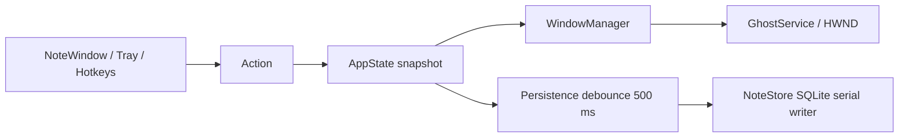

# Implementation decisions

**Selected: C# WinForms, .NET 10 LTS, Microsoft.Data.Sqlite 10.0.12. Windows-first.**

On October 13, 2026, the user requested that further testing stop, one stack be selected, and the complete app be built in a new folder. The benchmark stopped after 37 of 54 runs. Incomplete results are not presented as a final benchmark.

## Stack choice

WinForms provides native controls for a simple editor, direct HWND interop, and one main language for state, storage, windows, hotkeys, and tray functionality. The earlier WinForms 10 prototype passed its interaction checks. C++ had lower prototype RAM and package size, but requires more manual lifetime, GDI, and interop management. WinForms was selected for maintainability with relatively low prototype memory use.

Earlier prototype results, **not measurements of the current app**:

| Candidate | Observed private working set |
|---|---|
| WinForms 8, 10 notes | About 8.7 MiB in completed runs |
| WPF 8, 10 notes | About 92 MiB |
| Tauri 2, 10 notes | About 241–247 MiB, including the app and 15 WebView2 processes |
| C++ Win32, 10 notes | About 1.2–1.4 MiB |
| WinForms 10 | About 7.68 MiB for one complete one-note normal run; about 10–11 MiB in a 10-note smoke measurement |

These observations are not final medians for the entire protocol. Smoke measurements do not follow the 30-second warmup plus 60-second sampling protocol repeated three times. The current app adds SQLite, tray, and state handling and **has not been benchmarked**.

The WinForms 10 prototype self-contained package was 47.55 MiB compressed and 117.25 MiB installed files. Current package sizes and hashes are recorded in `artifacts/releases/*.json`.

WinForms and WPF are Windows-only. .NET 8 support ends November 10, 2026; .NET 10 LTS support ends November 14, 2028. Runtime patches still require maintenance.
[.NET support](https://dotnet.microsoft.com/en-us/platform/support/policy/dotnet-core), [WinForms overview](https://learn.microsoft.com/en-us/dotnet/desktop/winforms/overview/).

Tauri requires Rust, C++ Build Tools, and WebView2 on Windows. For this simple native text editor, the WebView and IPC overhead did not offer sufficient benefit. The official JavaScript API is `setContentProtected`, not `setContentProtection`; mouse handling uses `setIgnoreCursorEvents`.
[Tauri API](https://v2.tauri.app/reference/javascript/api/namespacewindow/).

## Ghost limitations

User32 `WDA_EXCLUDEFROMCAPTURE` requires Windows 10 version 2004 or later, a top-level window owned by the calling process, and DWM composition. Layered windows with WS_EX_TRANSPARENT provide click-through; WS_EX_TRANSPARENT alone is not a complete cross-process contract. The app checks API errors and affinity/style readback and restores normal input if configuration fails.
[Display affinity](https://learn.microsoft.com/en-us/windows/win32/api/winuser/nf-winuser-setwindowdisplayaffinity), [layered windows](https://learn.microsoft.com/en-us/windows/win32/winmsg/window-features#layered-windows).

Earlier WinForms and C++ experiments passed OBS Display Capture with DXGI/WGC. Existing Window Capture sources retained the image captured before ghost mode; a fresh BitBlt source also failed. A fresh WGC source created after ghost was enabled passed. The full capture gate **remains FAIL**. Proceeding with implementation does not change that evidence. The current app is not claimed to fix recorder behavior.

macOS and Linux are not supported. The Tao backend does not support Linux content protection, and NSWindowSharingNone does not protect against modern ScreenCaptureKit. No cross-platform ghost claim is made.
[Tao](https://docs.rs/tao/latest/tao/window/struct.Window.html#method.set_content_protection), [ScreenCaptureKit limitation](https://www.electronjs.org/docs/latest/api/browser-window#winsetcontentprotectionenable-macos-windows).

## Architecture and storage

AppState is the source of truth. Windows never access the database directly. Writes run serially in the background with transactions and parameterized SQL. A shutdown flush saves pending changes; save failures notify the user, and manual exit asks before discarding unsaved changes. No idle polling worker or application network connection is used.

The independent v1 schema uses notes columns id, text, theme, x, y, w, h, ghost, opacity, ghost_opacity, created_at, and updated_at. Settings store global ghost, hidden-all, and hotkey bindings. Normal and ghost opacity are separate. Global ghost overrides individual preferences without deleting them. The close button hides a note for the session; explicit deletion removes its row. Bounds use physical screen coordinates and are adjusted to available monitors when restored.

The state → window → storage concept is a **reconstruction from static analysis** used as architectural inspiration. No Microsoft Sticky Notes code, assets, app strings, or schema were copied. Microsoft's WindowPosition format is not used.

## Distribution and evidence limits

The self-contained package includes .NET; the framework-dependent package requires the .NET 10 Windows Desktop Runtime x64. NuGet dependencies are locked in packages.lock.json. Source is MIT licensed and dependency notices are included.

Inno Setup 6.7.3 packages the self-contained payload into one EXE, installs per-user under LocalAppData/Programs, creates shortcuts, and provides uninstall while preserving note data. The installer requires Windows 11 x64. A dedicated mutex prevents file replacement while the app is running.
[Official compiler download](https://jrsoftware.org/isdl.php); its Pyrsys B.V. publisher signature was verified before installing the compiler. The compiler is not an app runtime dependency.

Pushes to main build and publish the rolling `latest` Release; version tags publish separate releases. The workspace root and standalone app contain matching workflows. No push or GitHub publication was performed during local development, and the workflow has not run remotely.

The app, installer installation/upgrade/uninstall, screen sharing, and production memory use have not been runtime tested at the user's request. Installer compilation and Release packaging succeeded. No publisher signature, universal capture exclusion, or production certification is claimed.

All app-owned text, installer labels, release notes, and shipped documentation use English. The README is a short user guide; engineering evidence stays in this folder. User-written note content and historical raw experiment records are preserved.